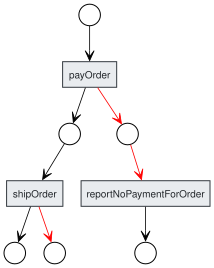

# Doer

[](https://mvnrepository.com/artifact/io.github.doer-lib/doer)

Doer is a Java library designed for building fault-tolerant, cluster-ready backend applications using annotations.

It simplifies distributed task execution, automatic retries, and state transitions, ensuring reliable processing of complex workflows.

> Version 1.0.0 introduces breaking changes to the API, runtime requirements, and Maven group ID (`io.github.doer-lib` instead of `com.java-doer`). For the 0.x version, see the [0.x branch](https://github.com/doer-lib/doer/tree/0.x).

## Features

- [Annotation-based API](api.1.x.md)
- Execution in distributed environments
- Automatic retries and failover
- Coordinated updates between Doer tasks and external APIs

## Usage

```xml
<dependency>
    <groupId>io.github.doer-lib</groupId>
    <artifactId>doer</artifactId>
    <version>1.0.0-beta2</version>
</dependency>
```

## Annotation processing since JDK 23

Since JDK 23, annotation processing needs to be activated explicitly.

> For details, read “Recommended Way to Activate Annotation Processing” in the Maven documentation https://maven.apache.org

You can enable all annotation processors by adding `-Dmaven.compiler.proc=full` to the `mvn` command. However, it is better to configure annotation processing explicitly:

```xml
<plugin>
    <artifactId>maven-compiler-plugin</artifactId>
    <configuration>
        <annotationProcessorPaths>
            <path>
                <groupId>io.github.doer-lib</groupId>
                <artifactId>doer</artifactId>
                <version>1.0.0-beta2</version>
            </path>
        </annotationProcessorPaths>
    </configuration>
</plugin>
```

## Example

See: https://github.com/doer-lib/doertutorial

The following code illustrates an order-processing workflow from the `Doer Tutorial`.

```java
@AcceptStatus(GOODS_RESERVED)
@RetryPolicy(interval = "5s", duration = "10s", fallbackStatus = PAYMENT_FAILED)
public void payOrder(Task task, Order order) {
    Check check = bank.processPayment(order);
    order.setPaymentTransactionId(check.transactionId());
    task.setStatus(ORDER_PAID);
}

@AcceptStatus(PAYMENT_FAILED)
public void reportNoPaymentForOrder(Task task, Order order) {
    order.setRejectReason("Payment not processed.");
    task.setStatus(REJECTED_NO_PAYMENT);
}

@AcceptStatus(ORDER_PAID)
@RetryPolicy(interval = "5s", duration = "5s", fallbackStatus = ORDER_NOT_SHIPPED)
public void shipOrder(Task task, Order order) {
    TrackId trackId = warehouse.shipTheOrder(order);
    order.setDeliveryTrackingId(trackId.token());
    task.setStatus(ORDER_SHIPPED);
}
```

Doer generates a workflow diagram for the business operations defined in your code, illustrating their state transitions and error-handling mechanisms.



## Video tutorials

Video tutorials are available on YouTube (https://www.youtube.com/@DoerLib), with text versions in the doertutorial wiki (https://github.com/doer-lib/doertutorial/wiki).

1. [Episode 01: The Core Concept Behind the Doer](https://github.com/doer-lib/doertutorial/wiki/Episode-01:-The-Core-Concept-Behind-the-Doer)
2. [Episode 02: Doer Methods - Implementing Business Operations with Doer](https://github.com/doer-lib/doertutorial/wiki/Episode-02.-Doer-Methods:-Implementing-Business-Operations-with-Doer)
3. [Episode 03: How to Read a Doer Diagram](https://github.com/doer-lib/doertutorial/wiki/Episode-03:-How-to-Read-a-Doer-Diagram)

## Tools

- [Doer Diagram Tool](https://www.java-doer.com/doer-diagram.html): visualize your Doer workflows

## Development

Contributions and feedback are welcome! Feel free to open an issue or submit a pull request.
